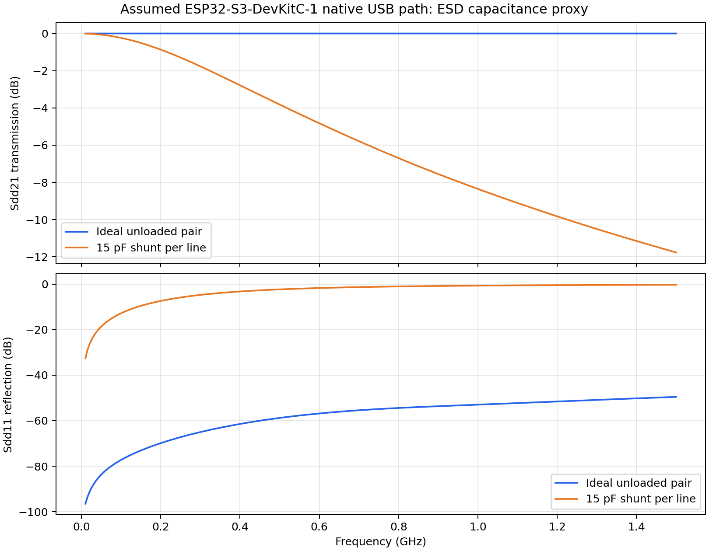

# Wall-E Simulation

An openEMS learning workspace for PCB electromagnetic simulations. The current examples are a simple microstrip and an illustrative ESP32-S3-DevKitC-1 USB trace pair. The actual Wall-E/SRA PCB has **not** been imported or simulated yet.

## Current progress

| Model | What is available | Status |
| --- | --- | --- |
| 20 mm microstrip, 3 mm and 4 mm traces | Python model, 3D XML, S-parameter CSV/plots, run logs, width comparison, older 100,000-step baseline | Learning runs only. Both 300,000-step runs stopped at the timestep cap before the −50 dB field-decay target. Their S-parameter curves are **not validated design results**. |
| ESP32-S3-DevKitC-1 native USB path | Differential D+/D− trace proxy, bare and 15 pF-per-line ESD-capacitance cases, 3D XML, geometry images, S-parameter CSV/plots and comparison | Both runs reached the field-decay target. Trace dimensions and stackup are assumed, and mesh/port convergence is not established. This does not predict USB compliance or whole-board behavior. |
| Actual Wall-E/SRA PCB | No imported board geometry or verified fabrication stackup | Next: select a routed feature, import its real copper and stackup, then check ports, boundaries, field decay, and mesh convergence. |

The DevKitC-1 model uses the [Espressif v1.1 schematic](https://dl.espressif.com/dl/schematics/SCH_ESP32-S3-DevKitC-1_V1.1_20221130.pdf) for the D−/GPIO19 and D+/GPIO20 connections and ESD-device placement. Its 15 pF shunts are a fixed small-signal proxy based on the [LESD5D5.0CT1G datasheet](https://datasheet.lcsc.com/lcsc/2211081800_Leiditech-LESD5D5-0CT1G_C5246195.pdf); the published PCB routing is not reproduced.



## Repository layout

```text
scripts/           OpenEMS simulation, plotting, and 3D viewer scripts
models/            Geometry XML files for AppCSXCAD
results/microstrip/       3mm, 4mm, baseline_100k, and width comparison
results/devkitc1_usb/     bare, esd15pf, and comparison
docs/              Short guides, PDFs, and their available generators
```

Each current result case has `sparams.csv`, `sparams.png`, a `run.log`, and generated solver data under `raw/`. The raw solver data, local openEMS source, and compiled toolchain are intentionally kept out of Git.

## Set up openEMS on Linux

Follow the [official openEMS installation guide](https://docs.openems.de/en/latest/install/clone-build-install.html) and [Python interface instructions](https://docs.openems.de/en/latest/install/python.html) for platform dependencies. The commands below install into the paths expected by the scripts, inside this checkout:

```bash
git clone --recursive https://github.com/thliebig/openEMS-Project.git vendor/openEMS-Project
cd vendor/openEMS-Project
./scripts/install_deps.sh --check --python
./update_openEMS.sh ../../toolchain/openEMS --python
cd ../..
```

If the dependency check reports missing packages, install them using the official guide before building. `vendor/` and `toolchain/` stay local and are ignored by Git.

## Run the examples

From the repository root:

```bash
./scripts/run.sh
./scripts/run.sh --trace-width-um 4000 --case microstrip_4mm
./scripts/run_devkitc1_usb.sh
./scripts/run_devkitc1_usb.sh --case devkitc1_usb_esd15pf --esd-cap-pf 15
./scripts/view_devkitc1_usb.sh
```

The viewer opens the ESD-loaded USB XML in AppCSXCAD by default. For the bare geometry, run `./scripts/view_devkitc1_usb.sh devkitc1_usb`.

To rebuild the comparison plots after changing model inputs:

```bash
toolchain/openEMS/venv/bin/python scripts/plot_width_comparison.py
toolchain/openEMS/venv/bin/python scripts/plot_devkitc1_usb_comparison.py
```

The PDF guides are in `docs/`. Their generators stay beside them; to rebuild the generated guides, create a separate Python environment with `docs/requirements.txt` and run the matching `docs/make_*.py` script.

## Interpretation limits

The microstrip runs did not reach their decay target; the sharp feature near 1.84 GHz is not established as a physical notch. The DevKitC-1 USB pair is a small, idealized passive model. Solver completion alone does not establish a correct PCB model: material properties, copper geometry, ports, terminations, mesh, and frequency-domain normalization still need validation against the intended board and, ultimately, measurements.

For background on EC-FDTD, see the [referenced paper](https://www.researchgate.net/publication/227133697_Equivalent_Circuit_EC_FDTD_Method_for_Dispersive_Materials_Derivation_Stability_Criteria_and_Application_Examples). Its PDF is not redistributed here.
